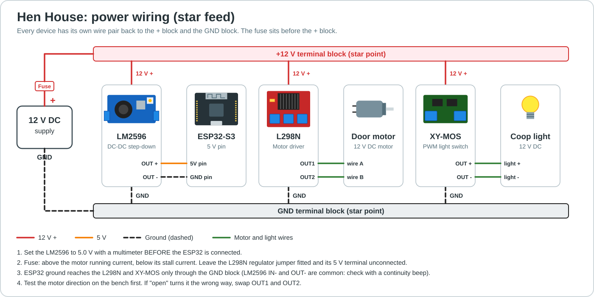
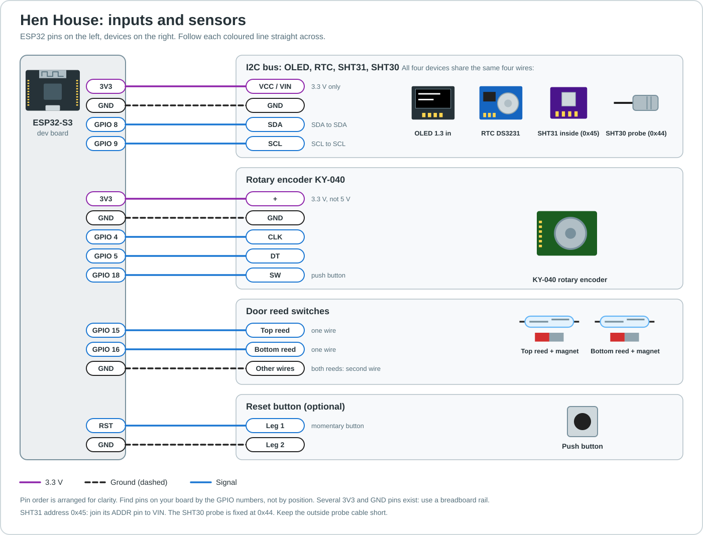
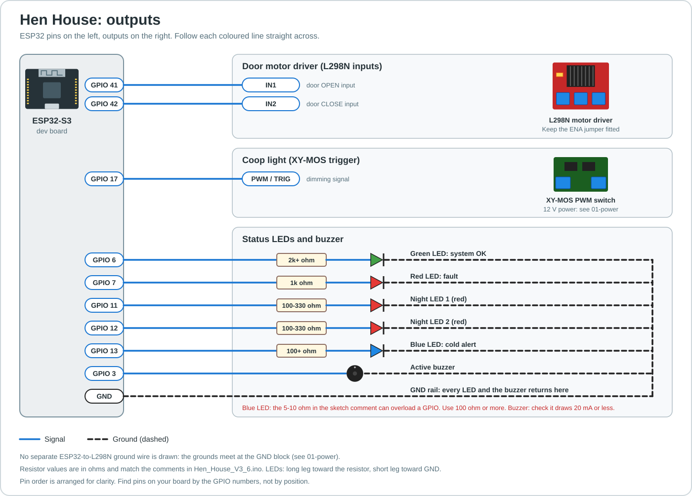

# Hen House Controller: Wiring Guide

Automatic coop door, light and monitoring on an ESP32-S3. Pin numbers come from `Hen_House_V3_6.ino`. These diagrams have not been tested on hardware.

Wire it in this order: power first, then inputs, then outputs.

## 1. Power (12 V star feed)

- Every device gets its own wire pair back to the + block and the GND block, so motor current never runs through the ESP32's supply wires.
- Set the LM2596 to **5.0 V with a multimeter before connecting the ESP32**. Feed the ESP32 through its **5V pin**, not 3V3.
- Leave the L298N 5 V terminal unconnected (with its regulator jumper fitted at 12 V it is an output).
- Fuse the 12 V + feed: above the motor running current, below its stall current.
- Bench-test the motor direction before fitting the door. If "open" runs the wrong way, swap OUT1 and OUT2, otherwise the door runs away from its limit switch.

## 2. Inputs and sensors

- OLED, RTC, SHT31 and SHT30 share one SDA/SCL pair. SHT31 ADDR to VIN gives address 0x45; the SHT30 probe is fixed at 0x44.
- Reed switches: one wire to the GPIO, the other to GND. No resistor (internal pull-up).
- Keep the outside SHT30 cable short.

## 3. Outputs

- L298N: keep the ENA jumper fitted. The sketch only drives IN1/IN2 and has no speed pin.
- XY-MOS is for low-voltage DC loads only. Never connect mains to it.
- Blue LED: the 5-10 ohm value in the sketch comment can overload a GPIO. Use 100 ohm or more.
- Buzzer: check it draws 20 mA or less, otherwise switch it with a transistor.

## Parts

ESP32-S3 dev board, LM2596 DC-DC module, L298N driver, XY-MOS PWM switch, 12 V DC motor, 12 V DC light, 1.3 in SH1106 OLED, DS3231 RTC, SHT31 and SHT30 sensors, KY-040 encoder, 2 reed switches with magnets, LEDs and resistors, active buzzer, reset button, fuse and terminal blocks.
